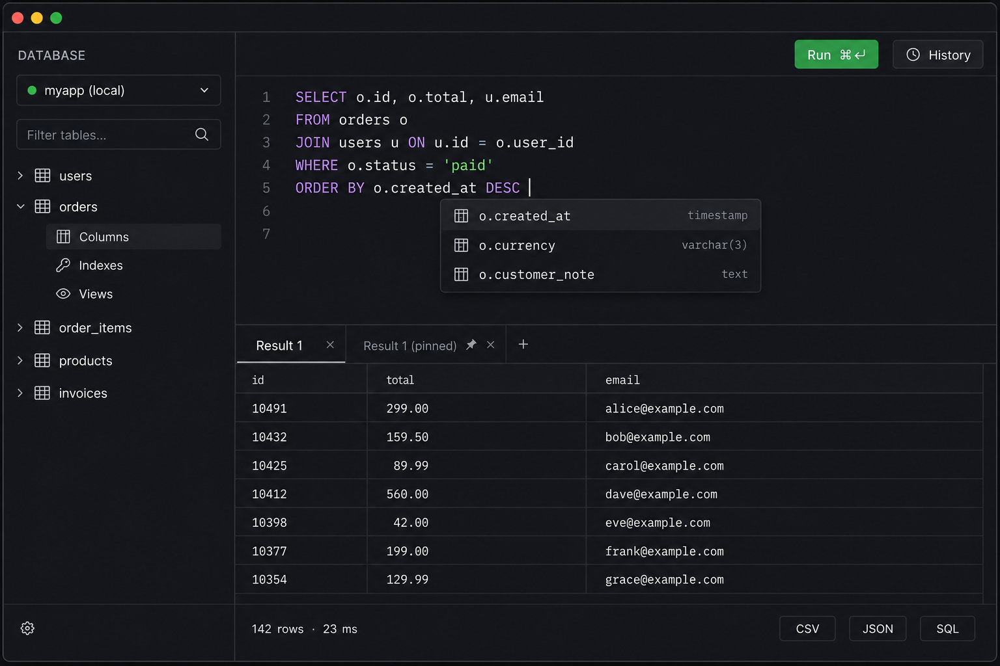
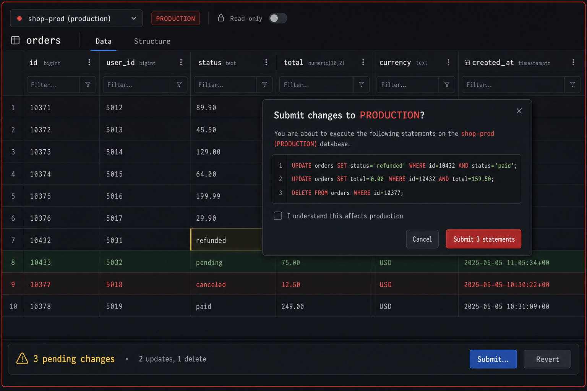

# PRD: Databaseverktøy i `e` — PhpStorm-paritet og forbi

| | |
| --- | --- |
| **Status** | Under arbeid — alle fem faser er påbegynt, mange krav er delvis levert |
| **Eier** | Knut W. Horne |
| **Baseline** | `e` v0.7.5 (juli 2026) |
| **Status oppdatert** | `e` v0.20.0 (november 2026), etter gjennomgang av koden; feilrettinger etter v0.20.0 (#54, #56) tatt med |
| **Referansenivå** | PhpStorm 2026.x database tools (DataGrip-motoren) |

## 1. Bakgrunn og mål

`e` har i dag et databasepanel (⌘3) som dekker hverdags-browsing og som allerede
slår PhpStorm på alt som er *app-nært*: auto-tilkobling fra `.env`, skjema-diff
mot migrasjoner, modellgenerering fra tabeller, Eloquent-/query-builder-
completion fra live-skjema, EXPLAIN med agent-indeksforslag, og produksjonsvern.

Målet med dette dokumentet er å definere hva som skal til for at DB-panelet
også er *database-nært* på nivå med PhpStorm — slik at en Laravel-utvikler aldri
trenger å åpne TablePlus, DataGrip eller PhpStorm ved siden av. Suksesskriteriet
er enkelt: **alt en Laravel-utvikler gjør mot databasen i løpet av en
arbeidsdag, skal kunne gjøres bedre i `e`.**

### Mål

1. Funksjonell paritet med PhpStorm på de arbeidsflytene Laravel-utviklere
   faktisk bruker (konsoll, datagrid, skjemaobjekter, import/eksport, historikk).
2. Beholde og forsterke `e` sine differensiatorer (Laravel-integrasjon, agent,
   runtime-kobling) — pariteten skal bygges *oppå* dem, ikke ved siden av.
3. Trygghet som førsteklasses egenskap: det skal være vanskeligere å ødelegge
   produksjonsdata i `e` enn i noe annet verktøy.

### Ikke-mål

- Full DataGrip-erstatter for DBA-er (brukeradministrasjon, replikering,
  partisjonering, jobs/schedulers). Målgruppen er applikasjonsutviklere.
- Støtte for flere databasemotorer enn dagens fire (MySQL/MariaDB, PostgreSQL,
  SQLite, ClickHouse). Nye motorer er egne initiativ.
- Diagram-*redigering* (ERD-tegning som endrer skjema). Visning er i scope.

## 2. Målgruppe og scenarier

**Primærbruker:** Laravel-/PHP-utvikler som i dag bruker PhpStorm eller
VS Code + TablePlus, og som jobber mot lokal database (Grove/Docker) daglig og
staging/produksjon (via SSH-tunnel) ukentlig.

Kjernescenarier som skal være friksjonsfrie:

1. **Utforske**: «Hva ligger i `orders`-tabellen for kunde X?» — filtrer, sorter,
   følg foreign keys, se JSON-kolonner leselig.
2. **Spørre**: Skrive ad-hoc SQL med completion, kjøre, iterere, sammenligne to
   resultater, finne igjen queryen i morgen.
3. **Fikse data**: Rette en rad i staging trygt — se hva som blir endret før
   commit, med angremulighet og prod-vern.
4. **Diagnostisere**: «Hvorfor er denne siden treg?» — fra runtime-panelets
   query-liste via EXPLAIN til indeks-migrasjon.
5. **Flytte data**: Få en CSV fra kunde inn i en tabell; få et resultatsett ut
   som CSV/JSON/inserts til en kollega.

## 3. Nåsituasjon (v0.20.0)

Ved v0.7.5 hadde panelet tilkoblinger, enkel datagrid, struktur-fane,
skrivevern, en ren tekstboks som query-editor, CSV-eksport, EXPLAIN med agent
og Laravel-laget. Siden da er alle fem faser påbegynt (CHANGELOG 0.8.0 sier
«the full PRD, phases 1–5»), men mange krav er levert i en tynnere form enn
beskrevet her. Status per krav står i §4; dette er hovedbildet:

**Levert:** highlighting og multi-statement i konsollen, query-historikk
(SQLite), paginering, NULL-håndtering, destruktiv-vern på alle miljøer,
`:param`-placeholdere, kansellering på serveren for alle fire motorer,
Keychain-lagring av passord, tre-filter, EXPLAIN fra runtime-panelet,
angre-logg for celleendringer.

**Delvis:** miljøetiketter (gjettes, kan ikke overstyres), transaksjonell
redigering (ikke for nye rader), verdi-visning (ikke redigering), completion
(uten alias, nøkkelord og funksjoner), resultat-faner, views, DDL, ERD (tekst,
ikke graf), eksportformater, CSV-import (uten mapping-dialog), snapshots (uten
gjenoppretting i UI), søk i data.

**Mangler:** triggere/prosedyrer, kopier celle/rad, dupliser rad,
Laravel-cellerendering, feilposisjonering, SQL-formatering, eksport av hel
tabell, `db_explain`/`db_snapshot` på agent-socketen.

### Kjente feil og hull (bør tas før nye krav)

1. **Å åpne en tabell sletter alle resultat-faner**, også pinnede (DB-404).
2. **Søk i data og EXPLAIN fra runtime-panelet bruker første tilkoblede
   database**, ikke den aktive.
3. **Konsoll-completion henter skjema fra `.env`-tilkoblingen**, ikke fra
   tilkoblingen konsollen kjører mot.

### Rettet etter v0.20.0

- **Ventende endringer forsvant stille** ved bla, sortering, filter og
  tabellbytte. De holdes nå per primærnøkkel og overlever til Submit eller
  Revert; endringslinjen sier hvilken tabell de gjelder (#54).
- **«+ Row» gikk utenom trygghetsrekkverket.** Mot ikke-lokale tilkoblinger går
  innsetting nå via bekreftelsesdialogen, og alle innsettinger logges (#54).
- **Read-only ClickHouse kunne ikke lese** (`readonly=1` nektet radgrensen);
  nå `readonly=2` (#56).
- **Klassifisereren lot seg lure** av siterte navn (`"set_config"`),
  `$$`-strenger og nestede kommentarer, og nektet ROLLBACK på read-only
  PostgreSQL (#56).
- **En begrenset PostgreSQL-lesing kunne kjøres to ganger** ved
  rettighetsfeil underveis (#56).
- **Cancel stoppet ikke resten** av en flersetnings-kjøring eller søk i data,
  og et tregt svar for forrige tabell kunne havne på den nye (#56).
- **Redigering av en tilkobling mistet etiketten** (og dermed en
  produksjonsmarkering gjettet fra den), og et nytt passord ble vist mens det
  ble skrevet (#56).

### Dokumentasjon som lover mer enn koden

- `docs/database.md` og CHANGELOG nevner nøkkelord-completion i konsollen;
  den finnes ikke.
- `docs/database.md` sier at resultater kappes ved 1000 rader; det gjelder nå
  bare konsollen (grid pagineres).
- CHANGELOG 0.8.0 nevner «agent-suggested index migrations» for SQL; fra
  konsollen er det bare en prompt til agenten, og «Suggest Index»-hintet i
  EXPLAIN-banneret er ikke klikkbart.

### Levert utenfor PRD-en

- **TLS per tilkobling**: Auto / Off / Require / Verify med valgfri CA-fil,
  lest fra `.env` (`DB_SSLMODE`, `MYSQL_ATTR_SSL_CA`); Verify gjennom tunnel
  sjekker det ekte vertsnavnet.
- **Skrivevern på serveren**, ikke bare i UI: read-only-sesjon i MySQL og
  PostgreSQL, SQLite åpnet read-only, ClickHouse `readonly=2`, og en
  token-klassifiserer foran konsoll, import, agent-queries og transaksjoner
  (med PostgreSQLs egen lesing av `$$`-strenger og nestede kommentarer).
- **Radgrense på serveren**: PostgreSQL stopper ved grensen, ClickHouse
  strømmes; store resultater leses ikke hele før de kappes.
- **PostgreSQL-feil** vises med serverens egen melding, DETAIL og HINT.
- **Skjema-cachen følger migrasjoner**: lokal `migrations`-tabell sjekkes
  jevnlig, og `.env`-databasen kobles til ved oppstart for completion.
- **Workspace trust**: panelet virker i begrenset modus; «Seed» (Tinker)
  holdes tilbake til prosjektet er klarert.
- **Tilkoblingsskjema** med gruppe, maskerte passord og validering av
  SSH-mål (avviser opsjons-injeksjon).
- Eloquent-EXPLAIN (⌥⌘⏎) med deterministisk indeks-migrasjon, Grove
  «migrate (snapshot first)», og agent-worktrees med egen kopi av databasen.

## 4. Funksjonelle krav

Prioritet: **P0** = kreves for paritet, **P1** = paritet for kraftbrukere,
**P2** = forbi paritet (differensiator). Krav merket ✅ i kravteksten var
levert allerede i v0.7.5.

Status per v0.20.0: **✅** levert, **◐** delvis (det som mangler står i
kolonnen), **✗** mangler. Statusen bygger på en gjennomlesing av koden, ikke
på manuell testing.

### 4.1 Tilkoblinger og miljøer

| ID | Krav | Prioritet | Status v0.20.0 |
| --- | --- | --- | --- |
| DB-101 | ✅ Auto-tilkobling fra `.env`, manuelle tilkoblinger, SSH-tunnel | — | ✅ |
| DB-102 | Miljø-etikett per tilkobling: `local` / `staging` / `production`, med farge (grønn/gul/rød) synlig i panel-header, datagrid og konsoll. Auto-gjettes (hostname, `.env` vs manuell) men kan overstyres | P0 | ◐ Gjettes fra navn og vert; prikk + badge i tilkoblingslisten, prikk i resultat-header, farget tittel i bekreftelsen. Etiketten beholdes nå når en tilkobling redigeres. Mangler: manuell overstyring, badge i grid/konsoll, farget grid-ramme, miljø i agent-consent |
| DB-103 | ✅ Read-only-flagg per tilkobling; produksjon read-only som standard | — | ✅ Alle ikke-lokale verter og SSH starter read-only. Bryteren lagres ikke. ClickHouse bruker `readonly=2` (radgrensen virker) |
| DB-104 | Flere samtidige tilkoblinger åpne, med rask bytte (dropdown i panel-header); aktiv tilkobling alltid synlig med miljøfarge | P0 | ◐ Flere tilkoblinger kan være åpne samtidig. Mangler: dropdown i header for å bytte aktiv tilkobling |
| DB-105 | Tilkoblingstest med tydelig feilmelding (DNS, auth, tunnel, driver) | P1 | ◐ Test-knapp viser driverens rå feil. Mangler: kategorier (DNS, auth, tunnel, driver) |
| DB-106 | Keychain-lagring av passord (macOS Keychain / Secret Service på Linux) i stedet for klartekst i prosjektfil | P1 | ✅ Faller tilbake til `databases.json` (0600) uten keyring |

### 4.2 Skjema-utforsker (objekttre)

| ID | Krav | Prioritet | Status v0.20.0 |
| --- | --- | --- | --- |
| DB-201 | ✅ Tabelliste med kolonner og indekser | — | ✅ |
| DB-202 | Views i objekttreet: liste, åpne definisjon (SQL), browse som tabell | P0 | ◐ Views listes, filtreres og kan browses. Mangler: vis definisjon (`e_db::view_definition` finnes, men brukes ikke); ClickHouse-views vises ikke |
| DB-203 | Triggere og prosedyrer/funksjoner: liste + vis definisjon (read-only) | P1 | ✗ |
| DB-204 | «Generate DDL» på tabell/view/indeks: vis `CREATE …`-setningen, kopier til utklippstavle | P1 | ◐ «Copy DDL» for tabeller til utklippstavlen; PostgreSQL uten indekser og FK-er. Mangler: views og indekser, visning i skuff |
| DB-205 | Søk/filter i objekttreet (skriv for å filtrere tabellnavn) | P0 | ✅ |
| DB-206 | Radantall per tabell (lazy, ca-verdi) og tabellstørrelse i treet | P2 | ◐ Radantall (≈ fra katalogen). Mangler: tabellstørrelse |
| DB-207 | ERD-visning: FK-graf over valgte tabeller (gjenbruk relasjonsgraf-motoren fra ⌘⌥R, men på DB-nivå — også for tabeller uten Eloquent-modell) | P2 | ◐ «⇄» lister alle FK-er som tekst. Mangler: graf og valg av tabeller |

### 4.3 Datagrid

| ID | Krav | Prioritet | Status v0.20.0 |
| --- | --- | --- | --- |
| DB-301 | ✅ Sortering, kolonnefiltre, celle-redigering, ny rad, slett rad, FK-hopping | — | ✅ Kolonnefilter er ett likhetsfilter fra en celle (chip), ikke en filterrad |
| DB-302 | Paginering: «neste/forrige side» + hopp til side, med totalantall; rad-cap erstattes av ekte sider | P0 | ✅ 200 rader per side, hopp til side, totalantall. Sidestørrelsen er ikke en innstilling; konsollen kappes fortsatt ved 1000 |
| DB-303 | Transaksjonell redigering: endringer (celler, nye rader, slettinger) samles lokalt og markeres visuelt; egen **Submit**-knapp kjører alt i én transaksjon, **Revert** forkaster. Direkte-skriv beholdes som opt-in for lokal utvikling | P0 | ◐ Celleendringer og slettinger samles per primærnøkkel og overlever bla, sortering, filter og tabellbytte; Submit/Revert i én transaksjon. Mangler: nye rader i endringssettet (lokalt skrives de direkte, ellers via bekreftelse), gjennomstreking, opt-in direkte-skriv |
| DB-304 | Verdi-editor: åpne celleverdi i eget felt/modal for lange tekster; JSON-kolonner vises formatert (pretty-print) med fold, og valideres før lagring | P0 | ◐ Skrivebeskyttet verdivisning med JSON pretty-print. Mangler: flerlinjers editor, fold, valider-før-lagre, ⌘Enter |
| DB-305 | NULL håndteres eksplisitt: vis `NULL` distinkt fra tom streng; sett-til-NULL-handling | P0 | ✅ Dim `NULL` (ikke kursiv), NULL-avkrysning i rediger- og ny rad-dialog |
| DB-306 | Kopier celle / rad (som CSV, JSON eller `INSERT`-setning) fra kontekstmeny | P1 | ✗ |
| DB-307 | Dupliser rad som utgangspunkt for ny | P1 | ✗ |
| DB-308 | «Relaterte rader»-oppslag: fra en rad, vis rader i andre tabeller som peker hit (reverse FK) | P1 | ◐ «Related →» åpner første tabell som peker hit; flere vises bare som antall |
| DB-309 | Binær-/blob-kolonner: vis størrelse + hex-preview i stedet for rå bytes | P2 | ◐ SQLite viser `<N bytes>`; MySQL viser bytes som UTF-8, PostgreSQL serverens tekstform. Mangler: hex-preview |
| DB-310 | Cell-rendering av vanlige Laravel-typer: timestamps med relativ tid på hover, boolske kolonner som ✓/✗ | P2 | ✗ |

### 4.4 SQL-konsollen

Dagens største gap. Konsollen skal oppleves som en editor, ikke en tekstboks.

| ID | Krav | Prioritet | Status v0.20.0 |
| --- | --- | --- | --- |
| DB-401 | Syntax-highlighting i konsollen (gjenbruk tree-sitter-SQL fra inline-SQL-arbeidet) | P0 | ✅ |
| DB-402 | Skjema-bevisst completion: tabellnavn, kolonnenavn (alias-bevisst: `o.` foreslår `orders`-kolonner), nøkkelord, funksjoner (gjenbruk completion-motoren fra inline SQL) | P0 | ◐ Tabeller etter FROM/JOIN/…, kolonner med type. Mangler: alias, nøkkelord, funksjoner, kolonner avgrenset til setningens tabeller; skjema fra konsollens tilkobling |
| DB-403 | Multi-statement: kjør hele konsollen, kjør valgt tekst, eller kjør setningen under markøren (⌘⏎); hver setning får eget resultat | P0 | ✅ |
| DB-404 | Flere resultat-faner: hver kjøring får en fane (med queryen som tooltip); faner kan pinnes; ikke-pinnede gjenbrukes | P0 | ◐ Pin (★) og gjenbruk. Mangler: query som tooltip; åpne tabell sletter alle faner |
| DB-405 | Query-historikk: alle kjørte queries logges per prosjekt (tid, tilkobling, radantall, varighet); søkbar liste, klikk for å gjenåpne i konsollen | P0 | ✅ Bare konsoll-kjøringer logges |
| DB-406 | ✅ Lagrede queries per prosjekt | — | ✅ Ingen UI for å slette en lagret query |
| DB-407 | Feilposisjonering: syntaksfeil fra serveren markerer riktig posisjon i konsollen der driveren oppgir den; «✨ Explain with agent» beholdes | P1 | ✗ Feilen vises som tekst; «Explain with agent» finnes |
| DB-408 | Parametere: `:navn`-placeholdere prompter for verdi ved kjøring (med husk-siste) | P1 | ✅ Siste verdier huskes bare i økten |
| DB-409 | Kansellerbar kjøring: lange queries kan avbrytes uten å fryse panelet | P0 | ✅ PostgreSQL cancel-token, MySQL/ClickHouse `KILL QUERY`, SQLite interrupt; stopper også resten av en flersetnings-kjøring |
| DB-410 | Format SQL-kommando i konsollen | P2 | ✗ |

### 4.5 Import og eksport

| ID | Krav | Prioritet | Status v0.20.0 |
| --- | --- | --- | --- |
| DB-501 | ✅ CSV-eksport av resultatsett | — | ✅ |
| DB-502 | Eksportformater: JSON, `INSERT`-setninger, Markdown-tabell, TSV — fra både grid og konsollresultat | P0 | ◐ Fil: CSV, JSON, INSERT. TSV og Markdown bare til utklippstavlen |
| DB-503 | CSV-import til eksisterende tabell: kolonnemapping-dialog med forhåndsvisning av de første radene, typevalidering, og alt-eller-ingenting-transaksjon | P0 | ◐ Kolonner mappes automatisk på navn, én transaksjon via bekreftelsen. Mangler: mapping-dialog, forhåndsvisning, typevalidering, oppsummering, progresjon |
| DB-504 | Eksporter hel tabell (ikke bare synlig resultat), med progresjon og avbrudd | P1 | ✗ |
| DB-505 | Kopier resultat til utklippstavle i valgt format uten å gå via fil | P1 | ◐ TSV og Markdown. Mangler: CSV, JSON, INSERT |

### 4.6 Ytelse og diagnose

| ID | Krav | Prioritet | Status v0.20.0 |
| --- | --- | --- | --- |
| DB-601 | ✅ EXPLAIN med agent-indeksforslag; indeksvisning i Structure | — | ✅ |
| DB-602 | Strukturert EXPLAIN-visning: plan som tre/tabell med markering av full table scans og manglende indekser (ikke bare råtekst) | P1 | ◐ Rå plan i grid + banner som lister full scans. Mangler: tre, kostnad per node |
| DB-603 | «Foreslå indeks → generer migrasjon»: agent-indeksforslaget skrives som ferdig Laravel-migrasjonsfil (gjenbruk kodegen) | P1 | ◐ Fra SQL bare en prompt til agenten; banner-hintet er ikke klikkbart. Deterministisk migrasjon finnes for Eloquent (⌥⌘⏎) |
| DB-604 | Kobling fra runtime-panelet (⌘⌥I): «EXPLAIN denne queryen» på enhver observert query, med hopp til DB-panelet | P1 | ✅ Bruker første tilkoblede database |
| DB-605 | Varighet og radantall vises for hver kjøring i konsoll og historikk | P0 | ✅ |

### 4.7 Trygghet (forsterker DB-102/103/303)

| ID | Krav | Prioritet | Status v0.20.0 |
| --- | --- | --- | --- |
| DB-701 | ✅ Prod-deteksjon med read-only som standard; consent-dialog for agent-queries | — | ✅ |
| DB-702 | Destruktive setninger (`DROP`, `TRUNCATE`, `DELETE`/`UPDATE` uten `WHERE`) krever eksplisitt bekreftelse med setningen gjengitt — på *alle* miljøer, ikke bare prod | P0 | ✅ |
| DB-703 | Ved skriv mot ikke-lokal tilkobling: bekreftelsesdialog viser miljøetikett i farge + antall rader som påvirkes | P0 | ◐ Miljøfarget tittel, setningene, avkrysning når ikke-lokal. «+ Row» går også via dialogen. Mangler: antall rader som påvirkes |
| DB-704 | Databasesnapshots: ta snapshot (mysqldump/pg_dump/SQLite-kopi) og tilbakestill, én knapp per tilkobling (kun lokale miljøer). Integreres med agent-flyter («ta snapshot før migrasjon») | P2 | ◐ Snapshot lokalt (SQLite, MySQL, PostgreSQL). Mangler: gjenoppretting i UI (`restore_snapshot` finnes), agent-flyt, ClickHouse |
| DB-705 | Angre-logg for datagrid-endringer i økten: liste over utførte skriv med generert motsatt setning der det er mulig | P2 | ◐ Angre-logg for celleendringer og innsettinger i økten (Undo for innsetting når primærnøkkelen ble oppgitt). Mangler: slettinger |

### 4.8 Laravel- og agent-lag (forbi paritet — skal bevares og utvides)

| ID | Krav | Prioritet | Status v0.20.0 |
| --- | --- | --- | --- |
| DB-801 | ✅ Skjema-diff, modellgenerering, Eloquent-/query-completion, validation-rules fra skjema, inline SQL i PHP | — | ✅ |
| DB-802 | Factory-integrasjon: «Seed N rader» på tabell (kjører factory via Tinker); «Generer factory fra skjema» der factory mangler | P1 | ◐ «Seed 10» via factory (fast antall, lokalt, krever trust). Mangler: valgt N, factory fra skjema |
| DB-803 | Migrasjonsgenerering fra strukturendringer: endrer man kolonner/indekser i Structure-fanen, tilbys en generert migrasjon i stedet for direkte DDL (direkte DDL kun på lokale miljøer) | P2 | ◐ «+ Migration» lager tomt `Schema::table`-skjelett. Structure kan ikke redigeres |
| DB-804 | Agent-socket utvides: `db_explain` (fritt, read-only) og `db_snapshot` (consent) | P2 | ✗ Socketen har `db_schema` og `db_query` |
| DB-805 | Søk i data: «finn verdi i alle tabeller» (begrenset til tekstkolonner, med radgrense og avbrudd) | P2 | ◐ LIKE over tekstkolonner, 200 rader per tabell. Cancel stopper før neste tabell. Mangler: velger første database, skiller store/små bokstaver på PostgreSQL |

## 5. Design

### 5.1 Overordnet layout

Ett panel, tre flater — objekttre til venstre, arbeidsflate (datagrid eller
konsoll) i midten, og kontekstuelle detaljer (verdi-editor, EXPLAIN, historikk)
som skuffer/modaler. Ingen nye toppnivå-paneler introduseres.

```
┌────────────────────────────────────────────────────────────────────┐
│ ● myapp (local) ▾   [PRODUCTION]   🔒 Read-only   ⚙                │  ← header
├──────────────┬─────────────────────────────────────────────────────┤
│ DATABASE     │  orders            [ Data ] [ Structure ] [ SQL ]   │
│ 🔍 filter…   │ ┌─────────────────────────────────────────────────┐ │
│ ▸ users      │ │  (datagrid  ELLER  konsoll + resultat-faner)    │ │
│ ▾ orders     │ │                                                 │ │
│   · Columns  │ │                                                 │ │
│   · Indexes  │ └─────────────────────────────────────────────────┘ │
│ ▸ Views      │  142 rows · 23 ms          [CSV ▾] [⏱ History]      │  ← statuslinje
├──────────────┴─────────────────────────────────────────────────────┤
│ ⚠ 3 pending changes · 2 updates, 1 delete      [Submit…] [Revert]  │  ← kun ved endringer
└────────────────────────────────────────────────────────────────────┘
```

- **Header** viser alltid aktiv tilkobling med miljøprikk (grønn/gul/rød),
  miljø-badge for ikke-lokale miljøer, og read-only-toggle (DB-102/103/104).
- **Objekttreet** har filterfelt øverst (DB-205); tabeller, views (DB-202) og
  per-tabell-noder for Columns/Indexes. Triggere/prosedyrer (DB-203) i egen
  gruppe nederst.
- **Arbeidsflaten** har tre faner per tabell/kontekst: Data, Structure, SQL.
  SQL-fanen er konsollen — den kan også åpnes uten tabellvalg.
- **Endringslinjen** (pending changes) vises kun når det finnes usendte
  endringer (DB-303), med Submit/Revert. Den er global for panelet, ikke per
  tabell, så endringer aldri «glemmes» bak en fanebytting.

### 5.2 SQL-konsollen



*Konsollen: tre-sitter-highlightet SQL, alias-bevisst kolonnecompletion med
typehint, resultat-faner med pin, radantall + varighet, eksportknapper.*

- **Editoren er en ekte `e-core`-buffer** med SQL-grammatikk: samme markør-,
  seleksjons- og keymap-oppførsel som editoren ellers (DB-401).
- **Completion-popup** gjenbruker editorens completion-UI: kolonneikon,
  navn, og datatype som dim høyrestilt hint (DB-402). Alias løses fra
  setningen (`o.` → `orders`).
- **Kjøring**: ⌘⏎ kjører setningen under markøren; er tekst markert, kjøres
  markeringen; «Run»-knappen kjører hele konsollen (DB-403). Under kjøring
  bytter Run-knappen til «Stop» (DB-409) og statuslinjen viser spinner + tid.
- **Resultat-faner** ligger mellom konsoll og grid: ikke-pinnede faner
  gjenbrukes av neste kjøring, pin-ikonet fryser en fane for sammenligning
  (DB-404). Tooltip på fanen viser queryen.
- **Historikk** åpnes fra ⏱-knappen som en skuff fra høyre: kronologisk liste
  med query (én linje, ellipsert), tilkobling, radantall, varighet og
  tidspunkt; søkefelt øverst; klikk limer queryen inn i konsollen (DB-405).
- **Feil** vises i resultatområdet med rød kant, feilmelding, posisjon
  markert i konsollen der driveren oppgir den, og «✨ Explain with agent»
  (DB-407).

### 5.3 Datagrid og transaksjonell redigering



*Datagrid mot produksjon: rød ramme + PRODUCTION-badge, endrede celler med gul
markering, ny rad grønn, sletting rød gjennomstreket, endringslinje nederst og
submit-dialog som gjengir de eksakte setningene.*

- **Kolonneheader** viser navn + dim datatype; ⋮-meny per kolonne har sorter,
  filter, skjul, og «Set NULL» på markert celle (DB-305). Filterraden ligger
  rett under headeren (DB-301).
- **Endringsmarkering** (DB-303): redigert celle får gul venstrekant + svak
  gul bakgrunn; ny rad grønn tint; slettet rad rød tint med gjennomstreking.
  Ingenting skrives før Submit.
- **Submit-dialogen** gjengir de eksakte parametriserte setningene som skal
  kjøres — samme «vis hva som skjer»-prinsipp som agent-consent. Mot
  produksjon kreves i tillegg avkrysning (DB-702/703). Mot lokale miljøer er
  dialogen én bekreftelsesknapp uten avkrysning.
- **FK-verdier** er lenker (understreket på hover); klikk hopper til referert
  rad (DB-301). «Relaterte rader» (DB-308) ligger i radens kontekstmeny.
- **Celle-editor** (DB-304): Enter redigerer inline; ⌘Enter eller dobbeltklikk
  på lange verdier åpner verdi-editoren som modal med tekstområde, JSON
  pretty-print/fold for JSON-kolonner, og valider-før-lagre.
- **Paginering** (DB-302): «‹ 1–500 av 12 340 ›» i statuslinjen; sidestørrelse
  i settings.
- **NULL** rendres som dim kursiv `NULL`, aldri som tom streng (DB-305).

### 5.4 Miljøfarger og trygghet i UI

| Miljø | Prikk/badge | Grid-ramme | Skriv |
| --- | --- | --- | --- |
| `local` | grønn, ingen badge | ingen | direkte eller transaksjonelt (opt-in) |
| `staging` | gul + badge | gul 1px når skrivbar | alltid transaksjonelt + bekreftelse |
| `production` | rød + badge | rød 2px når skrivbar | read-only som standard; skriv krever toggle + avkrysning |

Fargene følger temaets semantiske paletter (success/warning/danger) og vises i
panel-header, tilkoblings-dropdown, submit-dialoger og consent-dialoger for
agent-queries. En skrivbar prod-tilkobling skal være visuelt umulig å overse.

### 5.5 Dialoger og skuffer

- **CSV-import** (DB-503): tre-stegs modal — filvalg → kolonnemapping
  (kildekolonne → tabellkolonne, med forhåndsvisning av de fem første radene
  og typevalidering markert per celle) → oppsummering («12 340 rader →
  `orders`, 2 kolonner ignoreres») med import som transaksjon og
  progresjonslinje.
- **EXPLAIN** (DB-602): åpnes som skuff under resultatet; plan som innrykket
  tre med kostnad/radestimat per node; full table scans og «no index used»
  flagges med ⚠ og rød tekst; «✨ Foreslå indeks»-knapp → agent → generert
  migrasjon (DB-603).
- **Verdi-editor, historikk, DDL-visning** («Generate DDL», DB-204) bruker
  samme skuff-mønster som EXPLAIN — høyre side, lukkes med Esc, stjeler aldri
  fokus fra grid/konsoll uten klikk.

### 5.6 Tastatur

Alle flyter er tilgjengelige fra kommandopaletten (⌘⇧P) med prefiks
«Database: …». Direkte snarveier i panelet:

| Snarvei | Handling | Status v0.20.0 |
| --- | --- | --- |
| ⌘3 | Åpne/lukk databasepanelet | ✅ |
| ⌘⏎ | Kjør setning under markøren / markering | ✅ i konsollen |
| ⌘⇧⏎ | Kjør hele konsollen | ✅ |
| ⌘T (i panel) | Ny resultat-fane / pin gjeldende | ✗ ⌘T er global terminal; pin er klikk på ★ |
| ⌘S (i grid) | Submit ventende endringer | ✗ ⌘S er global lagring; Submit er en knapp |
| ⌘Z (i grid) | Angre lokal (usendt) endring | ✗ bare Revert av alt |
| Esc | Lukk skuff/modal; deretter Revert-fokus | ◐ lukker rediger-dialogen og completion; historikk, logg, bekreftelse, parametere, ny rad og ERD har bare ✕/Cancel |
| ⌘F (i grid) | Fokus kolonnefilter | ✗ global søk |
| ⌥⌘H | Åpne query-historikk | ✗ bare knappen |
| ⌥⌘⏎ | Explain SQL under markøren | ✅ (ikke i opprinnelig plan) |

Kommandopaletten har i dag bare Run SQL, Explain SQL, Suggest Index Under
Cursor og Toggle Database Panel — ikke «alle flyter».

### 5.7 Tilstander

- **Tom tilstand** (ingen tilkobling): sentrert kort med «Connect from .env»
  (primær, når `.env` finnes) og «Add connection manually» — samme mønster som
  welcome-skjermen.
- **Laster**: skeleton-rader i grid (ikke spinner-overlay); konsollen forblir
  interaktiv mens forrige resultat lastes.
- **Feil på tilkobling**: inline-kort i panelet med feilkategori (DNS, auth,
  tunnel, driver — DB-105) og «Test connection»-knapp; aldri en blokkerende
  dialog.
- **Alle operasjoner > 200 ms** viser progresjon og kan avbrytes; all I/O går
  via `spawn_bg`/`create_ext_action` (aldri på UI-tråden).

### 5.8 Konsistens

Gjenbruk eksisterende byggesteiner: toolbar-knapper, consent-dialogen
(agent-queries og submit deler visuell form), diff-/review-mønsteret, skuffer
og faner fra editoren. DB-panelet skal se ut som `e` — ikke som et innbakt
fremmed verktøy.

## 6. Tekniske føringer

- Alt databasespesifikt forblir i `e-db` (driverne); `e-app/src/db_state.rs`
  eier tilstand, `db_view.rs` kun visning. Konsollens editor gjenbruker
  `e-core`-bufferen med SQL-grammatikk, slik at completion/highlighting deler
  kode med inline-SQL.
- Query-historikk lagres i SQLite under `~/.config/e/` (én DB, prosjekt-nøkkel),
  ikke JSON — den vokser ubegrenset og må være søkbar.
- Kansellering (DB-409): kjør queries på dedikert tråd per tilkobling med
  kill-mekanisme per driver (`KILL QUERY` for MySQL, `pg_cancel_backend`/
  driver-API for PostgreSQL, avbrytbar handle for SQLite).
- Transaksjonell redigering (DB-303) bygger endringssettet som en liste av
  parametriserte setninger; genereres og vises for brukeren før submit
  (samme «vis hva som skjer»-prinsipp som agent-consent).
- ClickHouse er analytisk og har ikke transaksjoner — DB-303/503 degraderer
  til direkte-skriv med ekstra bekreftelse der.

**Slik er det bygget i v0.20.0** (avvik fra føringene over):

- Konsollen er en floem `TextDocument` med editorens tastebindinger, ikke en
  `e-core`-buffer. Highlighting deles via `e_core::syntax`, completion via
  `sql_completion_items`.
- Historikken ligger som planlagt i `~/.config/e/history.db`, nøklet på
  prosjektets rotsti, med en global grense på 10 000 innslag. Tømming skjer
  fra historikk-skuffen, ikke fra settings.
- Tilkoblinger lagres i `~/.config/e/databases.json` (0600, hemmeligheter i
  keychain), lagrede queries i `~/.config/e/queries.json` — ikke i prosjektet.
- Kansellering: hver kjøring er en egen tråd + `create_ext_action`, ikke en
  dedikert tråd per tilkobling. PostgreSQL bruker driverens `CancelToken`,
  MySQL `KILL QUERY <id>` fra en annen tilkobling, ClickHouse
  `KILL QUERY WHERE query_id …`, SQLite `InterruptHandle`. Resultatet
  forkastes uansett om serveren rekker å stoppe. Et stopp-flagg avslutter
  resten av en flersetnings-kjøring og søk i data, og et generasjonstall
  (`browse_gen`) hindrer at et sent svar for en tabell havner på en annen.
- Submit bygger literal SQL med `quote_literal`, ikke parametriserte
  setninger.
- ClickHouse kjører et endringssett setning for setning (best-effort), uten
  ekstra bekreftelse.

## 7. Faseplan

| Fase | Innhold | Kravdekning |
| --- | --- | --- |
| **Fase 1 — Konsollen** | Highlighting, completion, multi-statement, resultat-faner, historikk, varighet, kansellering | DB-401–405, 409, 605 |
| **Fase 2 — Trygg redigering** | Transaksjonell redigering, verdi-/JSON-editor, NULL-håndtering, destruktiv-vern, miljøetiketter, paginering | DB-302–305, 702–703, 102, 104 |
| **Fase 3 — Data inn/ut** | Eksportformater, CSV-import, kopier-som, views i treet, tre-søk | DB-502–503, 505, 202, 205 |
| **Fase 4 — Kraftbruker** | Strukturert EXPLAIN, indeks-migrasjon, runtime-kobling, factory-integrasjon, DDL-generering, relaterte rader, parametere | DB-602–604, 802, 204, 308, 408 |
| **Fase 5 — Forbi** | Snapshots, ERD, angre-logg, migrasjon-fra-strukturendring, søk i data, radantall i tre | DB-704, 207, 705, 803, 805, 206 |

Fase 1 og 2 utgjør til sammen «paritet i praksis» — etter dem skal en
PhpStorm-bruker ikke savne noe daglig. Fase 3 lukker de ukentlige behovene,
fase 4–5 er forspranget.

### Status per fase (v0.20.0)

| Fase | Levert | Delvis | Mangler |
| --- | --- | --- | --- |
| 1 — Konsollen | 401, 403, 405, 409, 605 | 402, 404 | — |
| 2 — Trygg redigering | 302, 305, 702 | 102, 104, 303, 304, 703 | — |
| 3 — Data inn/ut | 205 | 202, 502, 503, 505 | — |
| 4 — Kraftbruker | 408, 604 | 204, 308, 602, 603, 802 | — |
| 5 — Forbi | — | 206, 207, 704, 705, 803, 805 | — |

Ingen fase er helt ferdig. Krav utenfor faseplanen som mangler helt: 203,
306, 307, 310, 407, 410, 504, 804.

### Neste steg

1. **Rette de gjenværende feilene i §3**: faner som forsvinner ved
   tabellbytte, søk/EXPLAIN mot feil database, og completion fra feil
   tilkobling. (De to trygghetsbruddene — tapte ventende endringer og «+ Row»
   uten bekreftelse — er rettet i #54.)
2. **Fullføre fase 1 og 2** («paritet i praksis»): completion med alias,
   nøkkelord og riktig tilkobling (402); faner som overlever tabellbytte og
   viser queryen (404); nye rader i endringssettet og radantall i
   bekreftelsen (303, 703); verdi-editor (304); manuell miljøetikett og
   tilkoblingsbytte i header (102, 104).
3. **Rydde dokumentasjonen** som lover mer enn koden (§3).
4. Deretter fase 3: CSV-import med mapping-dialog (503), views med definisjon
   (202), kopier-som i alle formater (505).

## 8. Suksessmetrikker

- En definert «paritetssjekkliste» (kjernescenariene i §2) kan gjennomføres
  uten å forlate `e` — verifiseres manuelt per release.
- Ingen datatap-hendelser: alle skriv mot ikke-lokale miljøer går via
  bekreftelse; destruktive setninger kan ikke kjøres ureflektert.
- Konsollen brukes: query-historikken (lokal) viser at konsollen erstatter
  eksterne verktøy i eget daglig arbeid (dogfooding).
- Ytelse: åpne panel < 100 ms; completion i konsoll < 50 ms; grid ruller flytende
  med 10 000 rader lastet.

## 9. Risiko og avbøtninger

| Risiko | Avbøtning |
| --- | --- |
| Driver-forskjeller (fire motorer × alle features) gir kombinatorisk kompleksitet | Kapabilitets-flagg per driver i `e-db` (`supports_transactions`, `supports_kill`, …); UI degraderer eksplisitt i stedet for å feile. **v0.20.0: ikke gjort** — alt er `match Backend`, og degradering er stille (ClickHouse-views blir tomme) |
| Transaksjonell redigering med samtidige eksterne endringer (optimistic locking) | Submit matcher på de opprinnelige verdiene i `WHERE`-klausulen; ved 0 raders treff varsles konflikt og grid refreshes. **v0.20.0: ikke gjort** — `WHERE` matcher bare på primærnøkkel, og 0 rader varsles ikke |
| Query-kansellering er driver-spesifikk og skjør | Fallback: la queryen løpe ut i bakgrunnen, men frigjør UI og marker resultatet som forkastet. **v0.20.0: gjort**, og queryen stoppes nå også på serveren for alle fire motorer |
| Historikk-DB vokser | Rullerende grense (f.eks. 10 000 innslag) + manuell tømming i settings. **v0.20.0: gjort** (global grense 10 000; tømming fra historikk-skuffen) |
| Scope-kryp mot DataGrip | Ikke-målene i §1 håndheves; nye motorer/DBA-features krever egen PRD |

## 10. Åpne spørsmål

1. Skal konsoll-faner persisteres på tvers av økter (som editor-tabs) eller er
   historikken nok?
   *v0.20.0: ikke persistert — verken faner eller konsolltekst. Fanene
   overlever ikke engang et tabellbytte (§3), som bør rettes uansett svar.*
2. Miljøetikett: skal `staging` også være read-only som standard, eller kun prod?
   *v0.20.0: i praksis ja for fjerne verter — alle ikke-lokale verter og SSH
   starter read-only. En staging som bare gjenkjennes på navn, på lokal vert,
   er skrivbar. Valget lagres ikke.*
3. CSV-import: trenger fase 3 også Excel (`.xlsx`), eller er CSV nok for målgruppen?
   *v0.20.0: bare CSV.*
4. Snapshots (DB-704): begrenses til SQLite/MySQL lokalt i første omgang, eller
   må PostgreSQL med fra start?
   *v0.20.0: besvart — SQLite, MySQL og PostgreSQL, lokalt. Ikke ClickHouse.*
